<div align="center">


### Upload a dataset. Get instant metrics. Ask business questions in plain English.

[](https://www.python.org/)
[](https://fastapi.tiangolo.com/)
[](https://www.langchain.com/)
[](https://groq.com/)
[](https://pandas.pydata.org/)
[](https://render.com/)
[](#license)

[**Live Demo**](https://kuberis-ai-business-intelligence-agent.onrender.com)

</div>

<br>

## Overview

**Kuberis** turns a raw spreadsheet into an interactive analyst. Drop in a CSV or Excel file, and it reads the file, classifies what kind of dataset it is, calculates every headline metric it can find, and sits ready to answer natural-language questions about it — grounded entirely in the data you gave it.

The design principle: **Pandas calculates, the LLM explains.** Every number shown in the UI is computed directly from your dataset. The language model is never asked to invent a figure — only to turn a Pandas result into a clear answer, explanation, and recommendation.

That separation is also what makes the app resilient. If the model is rate-limited or returns a malformed response, the dashboard still loads with every metric intact — you lose the commentary, not the data.

<br>

## How it works

```mermaid
flowchart LR
    A["CSV / XLSX"] --> B["load · validate · classify<br/>Sales · Financial · BI"]
    B --> C["calculate_business_metrics<br/>7 KPIs, where a column matches"]
    C --> S{"generate_initial_insights"}

    S -->|"model answers"| SA["DatasetSummary<br/>via Groq"]
    S -->|"3 attempts fail"| SB["summarize_without_llm<br/>Pandas-only summary"]

    SA --> D["Dashboard<br/>metrics · preview · statistics"]
    SB --> D

    D --> Q["Question in<br/>plain English"]
    Q --> X["detect_intent · execute_analysis<br/>9 routed types, computed in Pandas"]
    X --> E["explain_result<br/>answer · explanation · recommendation"]

    style A  fill:#e4ddcf,color:#14293e,stroke:#a9832f
    style B  fill:#e4ddcf,color:#14293e,stroke:#a9832f
    style C  fill:#e4ddcf,color:#14293e,stroke:#a9832f
    style S  fill:#14293e,color:#e4ddcf,stroke:#a9832f
    style SA fill:#14293e,color:#e4ddcf,stroke:#a9832f
    style SB fill:#e4ddcf,color:#14293e,stroke:#8c8474
    style D  fill:#e4ddcf,color:#14293e,stroke:#a9832f
    style Q  fill:#e4ddcf,color:#14293e,stroke:#a9832f
    style X  fill:#e4ddcf,color:#14293e,stroke:#a9832f
    style E  fill:#14293e,color:#e4ddcf,stroke:#a9832f
```



| Stage | What happens |
|---|---|
| **1. Upload** | A `.csv` or `.xlsx` file arrives through the frontend, or the bundled sample dataset is loaded |
| **2. Validate** | `validate_dataset` checks the frame is usable and reports what is wrong if not |
| **3. Detect** | Column-name heuristics across 8 keyword groups classify the dataset as **Sales**, **Financial**, or general **Business Intelligence** |
| **4. Compute** | A Pandas metrics engine calculates 7 KPIs — sales, revenue, profit, expenses, average order value, customer count, product count — for every column it can match |
| **5. Summarise** | Groq writes the dataset overview, quality notes and suggested questions through LangChain structured output; if that fails three times, a Pandas-only summary takes its place |
| **6. Ask** | The user asks a question in plain English — *"which region had the highest sales?"* |
| **7. Route** | `detect_intent` maps the question to one of 9 analysis types |
| **8. Explain** | The Pandas result goes back to the model, which returns an answer, an explanation, and a recommendation |

<br>

## Features

- 📂 **Flexible ingestion** — CSV and Excel of any shape, no schema configuration
- 🔍 **Automatic classification** — Sales, Financial or general BI, inferred from column names alone
- 📊 **Zero-hallucination metrics** — every headline figure is a real Pandas calculation, never an LLM estimate
- 💬 **Natural-language Q&A** — *"top 5 products"*, *"how many customers?"* — answered from the data
- 🧭 **Intent-aware routing** — 9 query types: totals for sales, revenue, profit and expenses, customer counts, top products, regional performance, open-ended recommendations, and a general fallback
- 🛟 **Degrades instead of failing** — a rate-limited or malformed model response costs you the commentary, not the dashboard; the response carries an `ai_available` flag so the UI knows which it got
- 🔁 **Retry with backoff** — structured-output calls are retried three times, 1.5s apart, before the fallback engages
- 🗂️ **Data quality diagnostics** — missing values and duplicate rows surfaced automatically
- 🎨 **Custom-built interface** — a hand-designed FastAPI + HTML/CSS/JS frontend, not a dashboard template

<br>

## Tech stack

<div align="center">

| Layer | Technology |
|---|---|
| **Backend** |    |
| **Data processing** |   |
| **LLM orchestration** |   |
| **Frontend** |    |
| **Deployment** |  |

</div>

<br>

## Project structure

```
kuberis/
├── main.py                  # FastAPI app — routes, in-memory session store, summarise-or-fallback
├── config.py                # Settings and the Groq client factory
├── data_loader.py           # Parsing, classification, metric calculation, statistics
├── analyzer.py              # Structured-output retry, Pandas-only fallback, intent routing
├── models.py                # Pydantic schemas — DatasetSummary, BusinessMetrics, AnalysisResponse
├── prompts.py               # LangChain prompt templates
├── requirements.txt
├── filtered_sales.csv       # Bundled sample dataset
└── static/
    ├── index.html
    ├── style.css            # Ledger-inspired visual design
    └── app.js               # Upload flow, dashboard rendering, Q&A chat
```

<br>

## Getting started

### Prerequisites

- Python 3.10+
- A free [Groq API key](https://console.groq.com/keys)

### Installation

```bash
git clone https://github.com/WnagarAryan/Kuberis-AI-Business-Intelligence-Agent.git
cd Kuberis-AI-Business-Intelligence-Agent

pip install -r requirements.txt

echo "GROQ_API_KEY=your_key_here" > .env

uvicorn main:app --reload
```

Open **http://127.0.0.1:8000**.

<br>

## API reference

| Method | Endpoint | Description |
|---|---|---|
| `GET` | `/api/health` | Confirms the server is running and the API key is set |
| `POST` | `/api/upload` | Upload a CSV/Excel file; returns metrics, summary, preview and `ai_available` |
| `POST` | `/api/sample` | Load the bundled sample dataset |
| `POST` | `/api/ask` | Ask a question against an active session |

`/api/ask` returns **503** with a readable message if the model cannot answer, rather than a bare 500.

<br>

## Deployment

Kuberis ships as a single ASGI service.

**Render**
```
Build Command:  pip install -r requirements.txt
Start Command:  uvicorn main:app --host 0.0.0.0 --port $PORT
```

Set `GROQ_API_KEY` as an environment variable in the dashboard.

> Sessions are held in memory, so they reset whenever the server restarts — which on Render's free tier includes waking from sleep. Fine for a demo; the roadmap's first item for a reason.

<br>

## Design philosophy

The interface draws on the visual language of a physical ledger — ruled paper lines, a navy-and-brass palette, serif headings, monospaced figures — rather than a generic dashboard template. The goal was an interface that feels purpose-built for reading business records.

The same instinct runs through the backend. A business intelligence tool that invents a number is worse than no tool, so the model never sees a calculation it could get wrong: Pandas produces every figure, and the model is handed the result to describe.

<br>

## Roadmap

- [ ] Persistent session storage (currently in-memory, resets on restart)
- [ ] Multi-file comparison — analyse two datasets side by side
- [ ] Exportable PDF/Word reports of a Q&A session
- [ ] Chart generation for trend-based questions
- [ ] Pin dependency versions, so a rebuild cannot pull a breaking `langchain-groq`

<br>

## License

Distributed under the MIT License. See `LICENSE` for details.

<br>

<div align="center">

Built by [Aryan Nagar](https://github.com/WnagarAryan) · [GitHub](https://github.com/WnagarAryan) · [LinkedIn](https://www.linkedin.com/in/aryan-nagar-aa870a290/)

</div>
